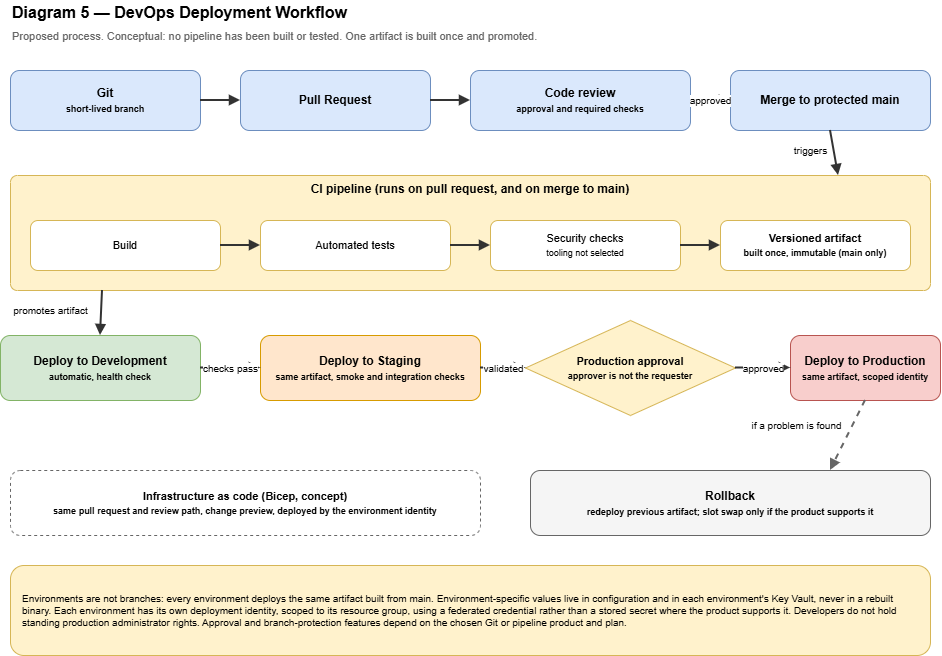

# Infrastructure Design: DevOps and Infrastructure Automation

> **Proposed, conceptual design.** No pipeline, template, or repository configuration has been created or tested. There is no executable code in this document. Folder names, branch names, and role names are examples. Assumption IDs (A-nn) refer to [`reference-scenario.md`](reference-scenario.md); decisions are in [`../decisions/architecture-decisions.md`](../decisions/architecture-decisions.md) (ADR-007, ADR-014, ADR-015, ADR-016, ADR-017).
> Statements about GitHub and Azure come from official documentation **accessed 2026-11-13** and must be re-verified before use. Statements marked *author's recommendation* are not vendor statements.

Diagram: **Diagram 5 — DevOps Deployment Workflow** (`diagrams/05-devops-deployment-workflow.drawio`).



## 1. Purpose and scope

This document describes how a change moves from a developer's laptop to Production in the reference organization: source control, review, build, test, artifact handling, promotion through the three environments, production approval, rollback, and how infrastructure itself is managed as code.

**In scope:** Git workflow, pull requests and review, continuous integration, artifact promotion, deployment identity, production approval, rollback, and Infrastructure as Code (Azure Bicep) as a concept.

**Out of scope:** executable pipelines or templates (ADR-007), a specific Git or pipeline product (A-09), the application's technology stack (A-04), sizing, and pricing.

## 2. DevOps-specific assumptions

| ID | Assumption | Consequence |
|----|------------|-------------|
| D-01 | The Git hosting and pipeline product is **not selected** (A-09) | Required capabilities are listed (section 12); product-specific facts are cited only as examples |
| D-02 | The application stack is unknown (A-04) | Build and test steps are described by purpose, not by tool |
| D-03 | About eight engineers contribute (six developers and two leads in the illustrative counts) | Approval rules must work with very few reviewers |
| D-04 | Development, Staging, and Production are separate environments in one subscription (ADR-002) | Promotion changes the target resource group, not the artifact |
| D-05 | Hosting and data products are deferred (ADR-004) | Rollback and database change guidance is product-neutral |

## 3. Principles

1. **Build once, deploy many.** The same immutable artifact moves through every environment.
2. **Environment is configuration, not code.** Differences between environments are held in configuration and secrets, never in rebuilt binaries.
3. **Everything reviewed.** Application code and infrastructure definitions both change through pull requests.
4. **No standing production access.** Production changes arrive only through the pipeline after approval (ADR-012, ADR-014).
5. **No long-lived secrets in the pipeline** where the platform allows an alternative (ADR-017).
6. **Rollback is designed in**, not improvised.
7. **Proportionality.** The process must be followable by eight people without a dedicated release team.

## 4. Source control and branching

**Repository layout (illustrative).** One repository per deployable application, and one for infrastructure definitions, or a clearly separated folder within the application repository.

```
app-repository/
├── src/                    application code
├── tests/                  automated tests
└── pipelines/              pipeline definitions (conceptual)

infra-repository/
├── modules/                reusable Bicep modules
└── environments/           parameter files for dev, stg, prod
```

**Branching trade-off**

| Option | Advantage | Disadvantage |
|--------|-----------|--------------|
| **A. Short-lived feature branches merged into a protected `main`** (chosen, ADR-015) | Simple; one source of truth; fast integration; fits a small team | Needs reliable automated checks; unfinished work must be hidden behind configuration if merged early |
| B. Long-lived branches per environment (`dev`, `staging`, `prod`) | Intuitive mapping | Branches drift; merges between them are error-prone; it encourages rebuilding per environment, which breaks "build once" |
| C. GitFlow-style release and hotfix branches | Structured releases | Heavy for eight people; more merge overhead |

**Rules (ADR-015):**

- `main` is always releasable and is protected.
- Branches live for days, not weeks, and are named by purpose (`feature/...`, `fix/...`).
- **Environments are not branches.** Every environment deploys an artifact built from `main`.
- Releases are identified by a version or commit identifier on the artifact, not by a branch.
- Direct pushes to `main` are blocked, including for administrators, where the product allows it.

## 5. Pull requests and code review

**Required before merging into `main`:**

| Control | Rule (illustrative) |
|---------|---------------------|
| Review | At least one approving review from someone other than the author; two for changes to infrastructure definitions, pipelines, or access. Counts are examples and depend on team size |
| Automated checks | The CI pipeline (section 6) must pass |
| Discussion | Review comments are resolved before merging |
| History | Squash or rebase merges for a readable history (optional) |
| Sensitive paths | Pipeline definitions and infrastructure definitions require review from a lead or the cloud administrator |

GitHub's documentation states that branch protection can require a set number of approving reviews, require status checks to pass, require conversation resolution, require signed commits, enforce linear history, block force pushes and deletions, and restrict who can push. It also states that protected branches are available in public repositories on GitHub Free, and in private repositories on paid plans, and that restricting who can push depends on the plan and on organization ownership. Equivalent features must be confirmed for whichever product is chosen (D-01).

**Review guidance (author's recommendation):** reviewers check correctness, tests, security impact (secrets, permissions, input handling), operational impact (logging, failure behavior), and whether a change needs a rollback plan. Reviews are a quality and knowledge-sharing control; they do not replace automated checks.

**Small-team trade-off.** With two leads, a rule that a lead must always approve can become a bottleneck or lead to rubber-stamping. The design therefore permits any engineer to approve routine changes, reserves lead or cloud-administrator approval for sensitive paths, and names an alternate approver.

## 6. Continuous integration

Triggered by a pull request (verification) and by a merge to `main` (artifact creation).

| Stage | Purpose | Notes |
|-------|---------|-------|
| Build | Compile or package the application | Fails on warnings the team has agreed to treat as errors |
| Automated tests | Run unit tests and fast integration tests | Test content and coverage targets are not set here |
| Static and security checks | Static analysis, dependency vulnerability checks, secret detection | **Tooling is not selected.** Availability depends on the Git or pipeline product and plan and must be confirmed |
| Artifact creation | Produce **one** versioned, immutable artifact | Only on `main`. Tagged with the commit identifier |
| Artifact storage | Store the artifact in a repository the pipeline can read | Retention period is not defined here, but it must cover the rollback window (section 10) |

Rules:

- The artifact is built **once**. Later stages never rebuild it.
- Checks that fail stop the pipeline; a failing check is not bypassed without a recorded exception.
- Test data contains no production data (Z-05).
- Pipeline logs must not print secrets.

No claim is made about test results, coverage, or the effectiveness of any scanner. None has been run.

## 7. Artifact promotion and environments

**Flow:** the artifact is deployed to Development, validated, promoted to Staging, validated again, approved, and promoted to Production. See Diagram 5.

| Stage | Trigger | Gate | Who can influence it |
|-------|---------|------|----------------------|
| Development | Automatic after the artifact is created | Deployment succeeds; basic health check passes | Developers (through merging reviewed code) |
| Staging | Automatic after Development succeeds, or on request | Smoke tests and agreed integration checks pass; a lead may add a manual check for risky changes | Developers and leads through the pipeline |
| **Production** | **Manual request** from a lead | **Explicit approval by a named approver other than the requester**, checks in Staging passed, and the artifact version is the one validated in Staging | Leads request; an authorized approver approves (section 8) |

**Configuration and secrets.** The artifact contains no environment-specific values. Each environment supplies its own configuration and reads application secrets from its own Key Vault through a managed identity (ADR-013). Database or other data-store changes must follow the guidance in section 10.

**Trade-off — promotion model**

| Option | Advantage | Disadvantage |
|--------|-----------|--------------|
| **Promote one immutable artifact** (chosen, ADR-016) | What was tested is what is deployed; reproducible; quick rollback to a known artifact | Needs artifact storage and disciplined configuration separation |
| Rebuild for each environment | Simple to start | The tested binary differs from the deployed one; harder to reproduce incidents |
| Deploy straight from `main` to Production | Fastest | No staging validation; no approval gate; unacceptable risk |

## 8. Production approval

**Principle:** a human who did not request the deployment confirms that it is intended, that Staging validation passed, and that a rollback path exists.

| Element | Design |
|---------|--------|
| Approvers | Members of `grp-leads`, with the cloud administrator as an alternate (access matrix) |
| Separation of duties | The requester cannot approve their own deployment |
| Preconditions | Pull request merged; checks passed; Staging validated on the same artifact; rollback artifact identified |
| Record | The approval, approver, artifact version, and time are recorded and linked to the change record (change management, Phase 7) |
| Timing | Avoid releasing when nobody is available to respond. Specific windows are not defined here |
| Emergency changes | Follow the emergency path in change management, with after-the-fact review. They still go through the pipeline |

**Provider capability (example, not a selection).** GitHub's documentation states that deployment environments can require up to six reviewers, of whom one needs to approve; can prevent self-review; can restrict which branches or tags can deploy; and can limit environment secrets to jobs that use the environment. It also states that on GitHub Free, Pro, or Team these protection rules, including required reviewers, are available only for **public** repositories, and that private repositories need an appropriate paid plan. A private organization must therefore confirm the product and plan before relying on a built-in approval gate.

**Trade-off — where approval lives**

| Option | Advantage | Disadvantage |
|--------|-----------|--------------|
| Built-in approval in the pipeline product | Enforced by the platform; recorded automatically | Depends on product and plan |
| Manual approval outside the pipeline (for example a recorded sign-off in a ticket) | Works with any product | Not technically enforced; relies on discipline and review |

The baseline is the built-in gate when the product provides it, and otherwise a recorded manual sign-off with restricted pipeline permissions.

## 9. Deployment identity and secrets

**Requirement:** the pipeline must authenticate to Azure without a long-lived stored password where possible.

Microsoft documents that GitHub Actions can authenticate to Azure with OpenID Connect, using a Microsoft Entra application or a user-assigned managed identity with a **federated identity credential** that trusts tokens issued by GitHub Actions for a repository. Its instructions store only the client ID, tenant ID, and subscription ID as GitHub secrets, and no client secret is listed. The page says to assign "an appropriate role" and does not itself specify the scope.

| Decision | Design (ADR-017) |
|----------|------------------|
| Method | Federated credential (workload identity federation) instead of a stored client secret. For another pipeline product, support must be verified |
| Identity per environment | One deployment identity per environment (`dev`, `stg`, `prod`). *Author's recommendation* |
| Scope | Each identity holds a role only at its own **resource group** (ADR-014). No subscription-scope role for pipeline identities |
| Role | The narrowest role that lets the pipeline deploy that environment's resources. The exact role must be verified |
| Production identity | Usable only from jobs that passed the production approval gate and only from `main` |
| Application secrets | In the environment's Key Vault, read through managed identities, never in the repository (security policy P-08) |
| Pipeline permissions | Pipeline definitions are protected by review; the pipeline cannot be edited to bypass the approval gate without review |

**Trade-off — federation versus stored secret**

| Option | Advantage | Disadvantage |
|--------|-----------|--------------|
| Federated credential (chosen) | No password to leak or rotate; tokens are short-lived and tied to the repository | Setup is more involved; depends on product support; trust configuration must be scoped precisely |
| Stored service-principal secret | Works anywhere; simple | A long-lived credential in the pipeline; must be rotated and protected; leaks have lasting impact |

## 10. Rollback

**Principle:** every production deployment has a known way back, and it has been rehearsed in Staging.

| Mechanism | How it works | When it applies | Limits |
|-----------|--------------|-----------------|--------|
| **Redeploy the previous artifact** (baseline) | Run the deployment of the last known-good artifact through the same pipeline and approval | Any hosting product (ADR-004) | Requires the artifact to be retained; data changes may not be reversible |
| Slot swap | Swap back to restore the pre-swap state | Only if the selected product supports it. Microsoft documents slots for App Service in the Standard, Premium, or Isolated tier, and states that swapping the same two slots again restores the "last known good site" | Product-specific; some settings are not swapped (Microsoft lists several), and long-running operations in recycled instances are abandoned |
| Disable a feature through configuration | A feature flag turns off new behavior | If the code was designed with flags | Needs design effort. *Author's recommendation* |
| Roll forward | Fix and release quickly | When rollback is riskier than fixing | Requires a fast, reliable pipeline |

**Rules:**

- **Decision owner:** the lead on duty decides between rollback and roll forward and records why.
- **Trigger:** defined by agreed signals, for example failed health checks or sustained errors after release. Thresholds are not set here.
- **Retention:** retain at least the last known-good artifacts for the rollback window. The window is not defined here.
- **Data changes (author's recommendation):** design database or data-store changes to be backward compatible with the previous version (for example, add before removing) so a rollback of the application does not require a risky data rollback. Data restoration from backup is a recovery action governed by the backup and restore procedures, not a routine rollback.
- **Practice:** rehearse a rollback in Staging periodically.

## 11. Infrastructure as Code (Azure Bicep, conceptual)

Microsoft describes Bicep as a declarative domain-specific language for deploying Azure resources. It states that Bicep is a transparent abstraction over Azure Resource Manager templates, that deployments are idempotent, that modules enable reuse, that the **what-if** operation previews changes before deployment, and that Azure stores state so no state files need managing. Per ADR-007, Bicep is a **documented concept** here, not a tested deliverable.

| Aspect | Design |
|--------|--------|
| Source of truth | Infrastructure definitions in the infrastructure repository, versioned and reviewed |
| Structure | Reusable modules (for example, resource group set, Key Vault, monitoring) and per-environment parameter files |
| Change path | Pull request, review (two reviewers for production-affecting changes), automated validation, a **preview of changes** attached to the review, then deployment by the environment's pipeline identity |
| Environments | Same modules, different parameters. Development is used to try changes first |
| Manual changes | Portal changes in Production are exceptions, recorded and reflected back into the definitions to avoid drift |
| Scope | Deployments target the environment's resource group with a scoped identity. Creating resource groups needs higher rights and is done by the cloud administrator account (ADR-014) |
| Secrets | Never in parameter files or definitions; referenced from Key Vault |

**Trade-off — IaC versus portal-managed infrastructure**

| Option | Advantage | Disadvantage |
|--------|-----------|--------------|
| IaC with review (chosen as the target) | Repeatable; reviewable; consistent environments; recoverable definitions | Learning curve; discipline needed to avoid drift; mistakes are applied at scale |
| Portal-managed | Fast for small changes; no tooling | Not reproducible; no review trail; environments diverge |

**Trade-off — IaC language**

| Option | Advantage | Disadvantage |
|--------|-----------|--------------|
| Bicep | Azure-native; the documentation describes it as transparent over Resource Manager templates | Azure-only |
| Multi-cloud IaC tooling | Works across providers | Additional tooling and state handling; not assessed here, and the scope is Azure |

This portfolio does not publish Bicep templates. If a sandbox becomes available, selected modules could be validated and marked *Implemented* (ADR-007).

## 12. Required capabilities of the Git and pipeline product (D-01)

The product is not selected. Whichever product is chosen must provide:

| Capability | Why |
|------------|-----|
| Protected branches with required reviews and status checks | Section 5 |
| Pull request review with comments and resolution | Section 5 |
| Pipelines triggered by pull requests and merges | Section 6 |
| Artifact storage with retention control | Sections 6 and 10 |
| Environment-scoped secrets and approval gates | Section 8 |
| Federated authentication to Azure (or a comparable short-lived mechanism) | Section 9 |
| Audit log of merges, deployments, and approvals | Evidence for reviews |
| Cost and plan model that fits a 15-person private organization | The requirement that gates are available on the chosen plan |

The selection is a separate decision and is not made here.

## 13. Access and responsibilities

| Role | Pipeline and repository responsibilities |
|------|------------------------------------------|
| Developer | Creates branches and pull requests; reviews others' changes; sees Development and Staging deployments |
| Senior Developer / Team Lead | Reviews sensitive paths; requests Production deployments; approves Production deployments requested by others; decides rollback |
| Cloud Administrator | Manages deployment identities, resource groups, and infrastructure definitions; alternate approver |
| IT Administrator | Manages repository and pipeline platform access, joiner and leaver steps |
| Management | Receives release information; does not approve technical deployments |

This follows the [access control matrix](../security/access-control-matrix.md): developers deploy to Development and Staging through the pipeline and do not hold production administrator rights.

## 14. Measuring whether the process works (author's suggestion)

Track a few outcomes without setting targets here: how long a change takes to reach Production, how often Production is deployed, how often a deployment needs a rollback or a fix, and how long it takes to recover. Targets depend on the business and are not defined.

## 15. Growth path

| Trigger | Extension |
|---------|-----------|
| More applications | Shared pipeline templates and common modules |
| More engineers | More reviewers, code-owner rules, merge queues |
| Compliance or customer demand | Stronger evidence trails, signed commits and artifacts |
| Higher release frequency | Progressive delivery (gradual traffic shifting) where the hosting product supports it |
| Production moves to its own subscription | Production pipeline and identity moved with it (ADR-002) |

## 16. Limitations

- No pipeline, template, or repository setting has been created or tested.
- The Git and pipeline product, the hosting product, and the test tooling are open.
- Approval and protection features depend on product and plan; GitHub facts are examples.
- Rollback behavior is described at concept level; product-specific details need verification.
- Thresholds, retention periods, and release windows are not defined.

## 17. Well-Architected quick check (self-review, not an official assessment)

| Pillar | Observation |
|--------|-------------|
| Reliability | Staging validation, rollback designed in and rehearsed; recovery objectives deliberately undefined |
| Security | Reviewed changes, no standing production access, no long-lived stored credential where federation is possible, environment-scoped secrets |
| Cost Optimization | Small, proportionate process; product and plan decision deferred with cost as a criterion |
| Operational Excellence | One artifact, consistent environments, IaC with review, recorded approvals |
| Performance Efficiency | No performance claims; test content is not defined |

## 18. Sources

Accessed 2026-11-13. Recommendations beyond these statements are the author's own.

| Topic | Source |
|-------|--------|
| Branch protection: required reviews, status checks, conversation resolution, signed commits, linear history, force-push blocking, plan availability | [GitHub Docs — About protected branches](https://docs.github.com/en/repositories/configuring-branches-and-merges-in-your-repository/managing-protected-branches/about-protected-branches) |
| Deployment environments: required reviewers, self-review prevention, branch restrictions, environment secrets, plan limits | [GitHub Docs — Managing environments for deployment](https://docs.github.com/en/actions/how-tos/deploy/configure-and-manage-deployments/manage-environments) |
| Authenticating GitHub Actions to Azure with OpenID Connect and federated credentials | [Microsoft Learn — Authenticate to Azure from GitHub Actions by OpenID Connect](https://learn.microsoft.com/en-us/azure/developer/github/connect-from-azure-openid-connect) |
| Bicep: declarative, idempotent, modules, what-if, no state files | [Microsoft Learn — What is Bicep?](https://learn.microsoft.com/en-us/azure/azure-resource-manager/bicep/overview) |
| Deployment slots and swap-back rollback | [Microsoft Learn — Set up staging environments in Azure App Service](https://learn.microsoft.com/en-us/azure/app-service/deploy-staging-slots) |
