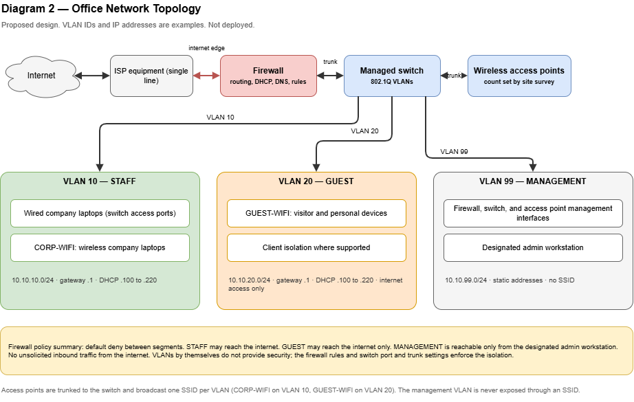

# Network Architecture

> **Proposed, illustrative design.** All VLAN IDs, IP addresses, SSID names, lease times, and device counts below are **examples**. Nothing has been configured or tested. Assumption IDs (A-nn) refer to [`reference-scenario.md`](reference-scenario.md); decisions are recorded in [`../decisions/architecture-decisions.md`](../decisions/architecture-decisions.md) (ADR-008, ADR-009).

Diagram: **Diagram 2 — Office Network Topology** (`diagrams/02-office-network-topology.drawio`).

## 1. Purpose and scope

This document describes the logical network of a single office for about 15 employees: how devices connect, how traffic is segmented, and which controls protect each segment.

**In scope:** internet connection, firewall, managed switch, wired and wireless access, VLAN and IP plan, DHCP, DNS, high-level firewall policy, guest isolation, remote access position, and network monitoring.

**Out of scope:** cloud networking in Azure (Phase 5), IPv6, vendor/model selection, cabling and floor plans, and physical site survey.

## 2. Network-specific assumptions

| ID | Assumption | Consequence |
|----|------------|-------------|
| N-01 | One office, one floor, one internet line (consistent with A-07) | No site-to-site links; no redundant WAN in the baseline |
| N-02 | No on-premises servers; business applications live in Microsoft 365 or Azure | No server VLAN in the baseline; no on-premises directory service |
| N-03 | The firewall, managed switch, and access points support 802.1Q VLANs and a stateful firewall policy | Hardware class is stated, not a specific product |
| N-04 | Staff use company-managed laptops (A-08); personal phones may use Wi-Fi | Personal devices are placed on the guest segment unless policy says otherwise |
| N-05 | IPv4 only is documented | IPv6 is a documented gap, not a design decision |

## 3. Components

| Component | Role | Notes |
|-----------|------|-------|
| ISP connection | Internet access | Single line (A-07). Equipment supplied by the ISP is treated as an untrusted upstream boundary. |
| Firewall | Internet edge, inter-VLAN routing and policy, DHCP, DNS forwarder | Single enforcement point for all inter-segment traffic (ADR-008) |
| Managed switch | Layer 2 switching, VLAN tagging, wired access ports, PoE for access points if available | Access ports for wired staff devices; trunk ports to the firewall and access points |
| Wireless access points | Staff and guest Wi-Fi | Quantity depends on a site survey; two is an illustrative figure |
| Admin workstation | Management of network devices | Reaches the management segment only through a designated path (see section 7) |

## 4. VLAN and IP addressing plan (illustrative)

Private IPv4 ranges are taken from the blocks reserved for private networks in RFC 1918 (`10.0.0.0/8`, `172.16.0.0/12`, `192.168.0.0/16`). No public IP addresses are used or invented in this document.

| VLAN ID | Name | Purpose | Subnet | Gateway | DHCP range | Status |
|---------|------|---------|--------|---------|------------|--------|
| 10 | STAFF | Company laptops and staff devices (wired and Wi-Fi) | 10.10.10.0/24 | 10.10.10.1 | 10.10.10.100 – 10.10.10.220 | Baseline |
| 20 | GUEST | Visitor and personal devices, internet only | 10.10.20.0/24 | 10.10.20.1 | 10.10.20.100 – 10.10.20.220 | Baseline |
| 99 | MGMT | Management interfaces of firewall, switch, and access points | 10.10.99.0/24 | 10.10.99.1 | None (static addresses) | Baseline |
| 30 | SHARED | Shared devices such as a printer, only if required | 10.10.30.0/24 | 10.10.30.1 | 10.10.30.100 – 10.10.30.150 | Optional, not deployed in baseline |

Design notes:

- **Sizing:** a /24 provides far more addresses than 15 employees with several devices each need. The reason for /24 is simplicity and growth headroom, not capacity pressure.
- **Static addresses (MGMT):** gateway `10.10.99.1`, switch `10.10.99.2`, access points `10.10.99.11` and up. Below `.100` in STAFF and GUEST remains free for static reservations.
- **Default VLAN:** avoid carrying user or management traffic on the switch's default VLAN 1. (Own recommendation.)
- **Lease times (illustrative):** staff devices one day, guest devices one hour, so guest addresses recycle quickly.
- **Gateway concept:** the firewall owns the `.1` address of every VLAN and routes between them. Hosts reach other segments or the internet only through it.
- **Documentation hygiene:** keep this table as the single source of truth and update it with every network change (see change management, Phase 7).

## 5. DHCP and DNS

| Service | Design | Reason |
|---------|--------|--------|
| DHCP | Provided by the firewall, one scope per VLAN (MGMT uses static addresses) | No on-premises servers (N-02); one device to manage |
| DNS for clients | Clients receive the VLAN gateway as DNS server; the firewall forwards queries to upstream resolvers | Central place to change resolvers; no internal DNS zone needed |
| Internal names | None required | Applications are cloud-hosted (N-02) |

**Trade-off — upstream DNS resolver**

| Option | Advantage | Disadvantage |
|--------|-----------|--------------|
| ISP resolver | Zero configuration | Less control and visibility; behavior depends on the ISP |
| Public recursive resolver | Easy, consistent, independent of ISP | Third-party dependency; queries leave the organization |
| Filtering/security DNS service | Can block known malicious domains | May involve cost or licensing; must be verified before adoption |

**Baseline:** a public recursive resolver or the ISP resolver, chosen by the organization. A filtering service is an optional enhancement and no pricing or feature claims are made here.

**Trade-off — where DHCP/DNS runs**

| Option | Advantage | Disadvantage |
|--------|-----------|--------------|
| On the firewall (chosen) | Simple; no extra server | Firewall outage also stops address assignment |
| On a separate server | Richer features | Needs a server to run and patch, which N-02 excludes |

## 6. Wi-Fi design

| SSID (example) | VLAN | Audience | Access |
|----------------|------|----------|--------|
| CORP-WIFI | 10 | Company-managed devices | Staff segment |
| GUEST-WIFI | 20 | Visitors and personal devices | Internet only |

The management VLAN is never exposed through an SSID.

**Staff Wi-Fi authentication — trade-off**

| Option | Advantage | Disadvantage |
|--------|-----------|--------------|
| A. Shared passphrase (WPA3-Personal, or WPA2/WPA3 transition mode for older clients) | Simple; no extra infrastructure | Everyone shares one secret; it must be changed when someone with knowledge leaves; no per-user identity in logs |
| B. 802.1X with a RADIUS server (WPA2/WPA3-Enterprise) | Per-user or per-device credentials; revocation follows the account | Needs a RADIUS service and credential/certificate design; integration with the organization's identity platform must be verified, not assumed |

**Decision (ADR-009):** option A as the baseline for 15 people, with a documented rotation rule at offboarding, and option B as the upgrade path.

**Guest Wi-Fi controls:**

- Separate SSID, VLAN 20, and separate passphrase, rotated periodically.
- Client isolation enabled so guest devices cannot talk to each other (if the access points support it).
- Firewall policy allows internet access only (section 7).
- Optional: bandwidth limits and a splash page; neither is required for security.

**What the Wi-Fi Alliance states about WPA3** (see sources): WPA3-Personal uses Simultaneous Authentication of Equals to make password guessing harder, WPA3 networks require Protected Management Frames, and WPA3-Enterprise offers stronger cryptography for sensitive environments. Open-network protection is a separate Wi-Fi Alliance program (Enhanced Open). Whether the chosen access points and every client support these modes must be verified per device.

## 7. Firewall policy (high level)

**Principle:** between zones the default is **deny**; each allowed flow is stated explicitly. A VLAN separates Layer 2 broadcast domains, but **VLANs alone do not provide security**. Isolation exists only if the Layer 3 gateway's rules, switch port configuration, and trunk settings enforce it. A misconfigured trunk or access port can defeat segmentation.

| # | From | To | Action | Notes |
|---|------|----|--------|-------|
| 1 | STAFF | Internet | Allow | Optional egress filtering later |
| 2 | STAFF | GUEST | Deny | |
| 3 | STAFF | MGMT | Deny, except designated admin host(s) | Management protocols must be encrypted; unencrypted ones disabled |
| 4 | GUEST | Internet | Allow | Web and standard services; no inbound |
| 5 | GUEST | STAFF, MGMT, SHARED | Deny | Core guest isolation rule |
| 6 | GUEST | Gateway | Allow DHCP and DNS only | No access to firewall management |
| 7 | MGMT | Internet | Allow only what updates and time sync need | Keep the list short |
| 8 | MGMT | STAFF, GUEST | Deny | |
| 9 | Internet | Any internal | Deny unsolicited inbound | No port forwarding in the baseline; public applications run in Azure |
| 10 | Any | Any | Log denied inter-zone traffic and administrative logins | Review on a schedule (Phase 7) |

**Management of network devices:** administration only from the MGMT segment, never from the internet side; vendor default credentials changed; unencrypted management protocols disabled; firmware kept current; configuration backed up securely. These practices follow CISA's guidance on securing network infrastructure devices.

**Trade-off — where inter-VLAN routing happens**

| Option | Advantage | Disadvantage |
|--------|-----------|--------------|
| Firewall routes between VLANs (chosen) | One policy point; simplest to audit | All inter-VLAN traffic crosses the firewall (not a concern at this size) |
| Layer 3 switch routes between VLANs | Faster internal routing | Policy split across two devices; more to configure and verify |

## 8. Remote access

**Baseline:** no VPN. Employees away from the office reach Microsoft 365 and Azure over the internet, protected by identity controls (Phase 4). This follows ADR-005.

Private connectivity would be added only if a resource requires it, for example an internal-only service or private administrative access. At that point the options and their trade-offs would be documented in a new ADR.

Remote administration of the office network itself is **not enabled** in the baseline. If it becomes necessary, the choice among a vendor's cloud management service, a VPN into the management segment, and a hardened admin host is a separate decision with its own risk assessment.

## 9. Network monitoring

| Area | Baseline practice |
|------|-------------------|
| Availability | Regular checks that the internet link, firewall, switch, and access points are reachable |
| Logs | Firewall and device logs retained for a defined period and reviewed on a schedule |
| Time | Consistent time source on all devices so logs correlate |
| Configuration | Backups of firewall, switch, and access point configurations, stored securely |
| Firmware | Tracked versions and a patching routine |

**Trade-off — monitoring approach**

| Option | Advantage | Disadvantage |
|--------|-----------|--------------|
| Built-in device dashboards | No extra tools | Per-device view; weak history and alerting |
| Dedicated monitoring tool | Central view and alerts | Needs hosting and maintenance, which conflicts with N-02 |
| Cloud-managed vendor service | Central view without on-premises hosting | Depends on the vendor; licensing must be verified |

The decision is documented in [`../operations/monitoring-and-alerting.md`](../operations/monitoring-and-alerting.md), section 8 (ADR-020): built-in device dashboards as the baseline, a cloud-managed vendor service as an optional enhancement, and no self-hosted tool. Retention periods and alert thresholds are not defined here.

## 10. Availability and risk

- **Single points of failure:** one ISP line, one firewall, one switch. An outage stops office connectivity.
- **Impact:** cloud services keep running, but staff in the office lose access to them until connectivity returns. A phone hotspot is a practical stopgap.
- **Not defined:** recovery objectives. RTO and RPO must come from business requirements (A-06).
- **Mitigation options when justified:** second ISP with failover, firewall high availability, spare hardware, documented restore of device configurations.

## 11. Growth path

| Trigger | Extension |
|---------|-----------|
| More staff or devices | More access points, larger or additional subnets |
| Frequent staff turnover or compliance need | 802.1X authentication (ADR-009 option B) |
| Printers or shared devices | Enable the optional SHARED VLAN |
| Business dependence on connectivity | Second ISP and failover, firewall high availability |
| Multiple offices | Site-to-site connectivity, an address plan that avoids overlaps across sites |

Planning ahead: choose non-overlapping ranges before adding sites or any private connection to Azure.

## 12. Limitations

- The plan has not been configured or tested on any device.
- Vendor features, performance, and licensing are not assessed.
- IPv6, cabling, power, and physical security of the network closet are not covered.
- Wi-Fi coverage and access point count require a site survey.

## 13. Well-Architected quick check (self-review, not an official assessment)

| Pillar | Observation |
|--------|-------------|
| Security | Segmentation with explicit deny rules, guest isolation, restricted management plane |
| Reliability | Single points of failure are acknowledged; no objectives invented |
| Cost Optimization | Firewall-based DHCP/DNS and no server avoid extra cost; optional items are deferred |
| Operational Excellence | One authoritative IP plan; logging, backups, and review routines named |
| Performance Efficiency | Sized for 15 users; no performance claims made |

## 14. Sources

Accessed 2026-11-13. These are the official documents behind the claims marked above; design choices and recommendations are the author's own.

| Topic | Source |
|-------|--------|
| Private IPv4 address blocks | [RFC 1918 — Address Allocation for Private Internets](https://www.rfc-editor.org/rfc/rfc1918) |
| WPA3-Personal, WPA3-Enterprise, Protected Management Frames, Enhanced Open | [Wi-Fi Alliance — Wi-Fi CERTIFIED WPA3 announcement](https://www.wi-fi.org/node/35501) |
| Securing network infrastructure devices, segmentation, management access, logging | [CISA — Securing Network Infrastructure Devices (ST18-001)](https://cisa.gov/tips/st18-001) |
