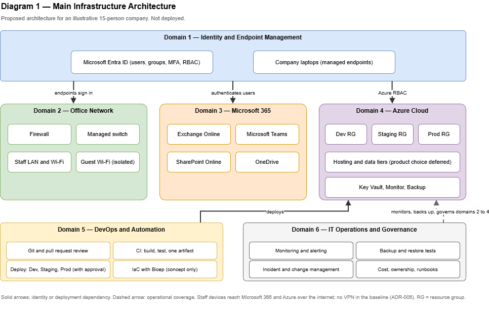

# Architecture Overview

> **Proposed architecture for an illustrative 15-person software company.** Nothing described here has been deployed or tested. See the [README](../README.md) for status labels and limitations, and [`reference-scenario.md`](reference-scenario.md) for assumptions (A-nn) referenced below.

## 1. Purpose of this document

This document explains how the six architecture domains relate to each other: what depends on what, where trust boundaries sit, and which flows matter. It is intentionally concise. Detailed designs live in the domain documents listed in section 8.

The corresponding diagram is **Diagram 1 — Main Infrastructure Architecture** (`diagrams/01-main-architecture.drawio`).

## 2. Architecture at a glance

The design has one **identity foundation** (Microsoft Entra ID) that everything else relies on, and three **service planes** that employees and engineers use: the office network, Microsoft 365, and Azure. Two **cross-cutting domains** (DevOps and IT Operations) connect these planes and keep them maintainable.

| Layer | Domain | Role in the architecture |
|-------|--------|--------------------------|
| Foundation | 1. Identity and Endpoint Management | Who a user is, what they may do, and whether their device is trustworthy |
| Service plane | 2. Office Network | Connectivity and local segmentation for staff and guests |
| Service plane | 3. Microsoft 365 and Collaboration | Email, chat, files, and documents |
| Service plane | 4. Azure Cloud Infrastructure | Hosting for Development, Staging, and Production workloads |
| Cross-cutting | 5. DevOps and Automation | How code and infrastructure changes reach Azure |
| Cross-cutting | 6. IT Operations and Governance | How everything is monitored, backed up, changed, and owned |

## 3. Domain relationships

| From | To | Relationship |
|------|----|--------------|
| Identity (1) | Microsoft 365 (3) | Entra ID authenticates users and holds group membership used for licensing and permissions |
| Identity (1) | Azure (4) | Entra ID is the identity source for the Azure portal and Azure RBAC role assignments |
| Identity (1) | DevOps (5) | Engineers and pipelines authenticate to Azure through Entra ID identities |
| Office Network (2) | Internet / cloud services | Staff devices reach Microsoft 365 and Azure endpoints over the internet through the office firewall |
| Office Network (2) | Identity (1) | Company laptops on the staff network are the managed endpoints that sign in to Entra ID |
| DevOps (5) | Azure (4) | Pipelines deploy the same build artifact to Development, Staging, and Production |
| Operations (6) | Azure (4), Microsoft 365 (3), Network (2) | Monitoring, backup, change control, and ownership apply to all three planes |
| Operations (6) | Identity (1) | Access reviews, onboarding, and offboarding are operational processes executed against Entra ID |

**Key point:** the office network is *not* the gateway to Azure or Microsoft 365. Both are cloud services reached over the internet and protected by identity and access controls. This is why VPN is not part of the baseline (see ADR-005). It would be added only if resources require private network connectivity.

## 4. Trust boundaries

| Boundary | Separates | Primary control |
|----------|-----------|-----------------|
| Internet edge | Office network from the public internet | Firewall rules (default deny inbound) |
| Guest / staff | Visitor devices from company resources | Separate network segment with firewall restrictions (detailed in Phase 3) |
| Identity boundary | Authenticated users from everyone else | Entra ID sign-in and MFA |
| Privilege boundary | Ordinary accounts from administrative accounts | Separate admin accounts, least-privilege RBAC |
| Environment boundary | Development / Staging / Production | Azure RBAC and resource-group scoping (logical separation — see ADR-002) |

In this design, **identity is the primary security perimeter** for cloud resources. Network controls protect the office; they do not protect Azure or Microsoft 365 data.

## 5. Key flows

**5.1 Employee sign-in and access.** An employee signs in to a company laptop and to Microsoft 365 or the Azure portal with an Entra ID account. MFA is part of the baseline; which enforcement mechanisms are available depends on licensing (A-03, ADR-003). Group membership determines access.

**5.2 Change delivery.** A developer changes code in Git, opens a pull request, a reviewer approves it, and the pipeline builds one artifact. That same artifact is deployed to Development, validated in Staging, and promoted to Production after an explicit approval. Detail in Phase 6.

**5.3 Operations loop.** Monitoring and logging detect problems; incidents and changes are handled through documented processes; backups are verified by restore tests. Detail in Phase 7.

## 6. Design trade-offs at the overview level

| Decision | Chosen | Alternative | Trade-off |
|----------|--------|-------------|-----------|
| Where the security perimeter sits | Identity-centric (Entra ID) with office firewall for local network | Network-centric (VPN into a private network for everything) | Identity-centric is simpler and cheaper and fits cloud services reached over the internet, but it depends heavily on correct identity configuration and MFA. Network-centric adds private connectivity but also cost and operational burden (ADR-005). |
| Number of Azure subscriptions | One, with resource groups per environment | One per environment | Lower overhead versus stronger isolation (ADR-002). |
| Application hosting | Deferred; shown as a generic "hosting tier" | Pick a specific service now | Avoids guesswork versus a less concrete diagram (ADR-004). |
| Licence-dependent controls | Optional enhancements over a baseline | Design around premium features | Honest and affordable baseline versus possibly weaker controls until upgraded (ADR-003). |

## 7. Assumptions and limits specific to this overview

- Labels in Diagram 1 are generic on purpose (for example "Hosting tier", "Data tier") because the application stack is unknown (A-04).
- The diagram shows logical relationships, not network paths or sizing.
- No RPO/RTO values appear anywhere; they must come from business requirements (A-06).

## 8. Where the details live

| Topic | Document | Phase |
|-------|----------|-------|
| Office network, VLANs, Wi-Fi | `network-architecture.md` | 3 |
| Entra ID, MFA, access matrix | `security/identity-management.md`, `security/access-control-matrix.md` | 4 |
| Azure resources | `cloud-architecture.md` | 5 |
| CI/CD and IaC concepts | DevOps sections of `infrastructure-design.md` | 6 |
| Monitoring, backup, incidents, changes | `operations/*.md` | 7 |
| Decisions and rationale | `decisions/architecture-decisions.md` | 1 onward |

## 9. Well-Architected review note

The five Azure Well-Architected pillars (Reliability, Security, Cost Optimization, Operational Excellence, Performance Efficiency) will be used as a practical checklist in Phase 8. This is a self-review aid, not an official Microsoft assessment, and no assessment has been performed.
