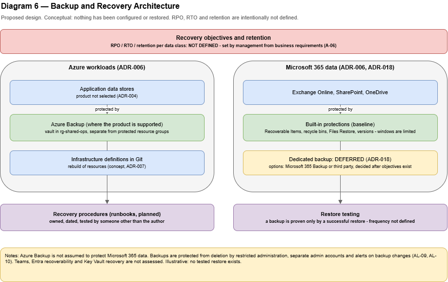

# Backup and Recovery

> **Proposed, illustrative design.** Nothing here has been configured, run, or tested. Recovery objectives (RPO and RTO) and retention periods are **intentionally not defined**: they must come from business requirements (A-06). Assumption IDs (A-nn) refer to [`../architecture/reference-scenario.md`](../architecture/reference-scenario.md); decisions are in [`../decisions/architecture-decisions.md`](../decisions/architecture-decisions.md) (ADR-006, ADR-018).
> Statements about Microsoft services come from official documentation **accessed 2026-11-13** and must be re-verified before use. Statements marked *author's recommendation* are not vendor statements.

Diagram: **Diagram 6 — Backup and Recovery Architecture** (`diagrams/06-backup-and-recovery.drawio`).

## 1. Purpose and scope

This document describes how the reference organization protects its data and how it would recover from loss. It keeps the protection of **Azure workloads** and **Microsoft 365 data** separate (ADR-006), defines a process for setting recovery objectives, and requires restore testing.

**In scope:** data inventory, protection approach per platform, recovery scenarios, objective-setting process, restore testing, and responsibilities.

**Out of scope:** product selection for dedicated Microsoft 365 backup, pricing, numeric RPO/RTO and retention values, and detailed restore procedures (see runbooks in [`governance-and-runbooks.md`](governance-and-runbooks.md)).

## 2. Principles

1. **A backup is proven only by a successful restore.** A completed backup job is not evidence of recoverability.
2. **Different platforms, different protection.** Azure Backup is not assumed to protect Exchange Online, SharePoint Online, or OneDrive (ADR-006).
3. **Built-in protection is not a recovery plan.** Retention and recycle-bin windows are time-limited features; whether they meet the business need is a decision, not an assumption.
4. **Objectives come from the business.** No RPO, RTO, or retention value is invented here.
5. **Protect the backups.** Backups must resist accidental deletion, malicious deletion, and ransomware.
6. **Rebuildable by design.** Where possible, systems are recreated from reviewed definitions rather than restored as opaque images.

## 3. Definitions

| Term | Meaning |
|------|---------|
| RPO (recovery point objective) | The maximum acceptable amount of data loss, expressed as time |
| RTO (recovery time objective) | The maximum acceptable time to restore a service after an incident |
| Backup | A separate, restorable copy of data |
| Retention | How long recovery points are kept |
| Restore test | A recorded exercise that restores data or a service and checks it works |

## 4. Data inventory and protection approach

| Data or system | Platform | Built-in protection (Microsoft documentation) | Gap to evaluate | Planned approach |
|----------------|----------|-----------------------------------------------|-----------------|------------------|
| Mailboxes | Exchange Online | Recoverable Items folder: deleted items kept **14 days by default, 30 days maximum** if configured; single item recovery can keep purged items for the retention period | Windows are short; not a long-term backup | Built-in baseline plus the decision in section 8 |
| Files in SharePoint and OneDrive | SharePoint Online, OneDrive | Recycle bin **93 days**; Files Restore to any point in the last **30 days** for a document library (uses file versions; default **500** versions for new libraries); metadata backups **14 days** | Windows are limited; versions can be reduced; bulk or malicious overwrite needs more than the recycle bin | Built-in baseline plus the decision in section 8 |
| Teams content | Stored in underlying Microsoft 365 services | Coverage depends on the workload that stores the content | **Not assessed here**; verify per content type | Verify and document |
| Identity objects (users, groups, roles) | Microsoft Entra ID | Not assessed here. Microsoft publishes tenant recoverability guidance that has not been reviewed in this portfolio | Recreating configuration after a tenant incident | Keep documented configuration in the repository; review Microsoft's tenant recoverability guidance before relying on this |
| Azure workloads (compute, data, storage) | Azure | Azure Backup supports named workloads (see cloud architecture, section 10) | Coverage depends on the hosting and data products, which are not selected (ADR-004) | Azure Backup for the products actually chosen; verify the support matrix |
| Infrastructure definitions | Git repository | Versioned, reviewed history | The repository itself needs protection | Hosted repository plus a documented copy or mirror (author's recommendation); provider not selected (A-09) |
| Build artifacts | Artifact storage | Retained for the rollback window | Retention is not defined | Retain at least the rollback window (infrastructure design) |
| Application secrets | Azure Key Vault | Not assessed here; recovery protections must be verified | Accidental deletion of secrets or vaults | Verify recovery protections when the vaults are designed (ADR-013); keep a documented rotation procedure |
| Network device configurations | Office devices | None by default | Device failure, misconfiguration | Securely stored configuration exports, updated at every change (network architecture) |
| Company laptops | Endpoint | Data lives in OneDrive or repositories; devices are re-imageable | Locally stored data not synchronized | Policy: work data on approved services; BitLocker recovery keys in controlled custody (identity management) |
| Emergency access credentials | Offline custody | Not applicable | Loss of the only recovery path into the tenant | Held by authorized individuals in separate secure locations (identity management) |

## 5. Protection design

### 5.1 Azure workloads

- Protected with **Azure Backup** where the selected product is supported. Microsoft's overview names Azure Virtual Machines and Disks; SQL Server, SAP HANA, SAP ASE, PostgreSQL, MySQL Flexible Server, and Azure Cosmos DB; Azure Files, Blobs, and Data Lake Storage; and AKS. It describes soft delete, immutable backup, role-based access control, and a Recovery Services vault isolated from the production environment.
- Backup vault in `rg-shared-ops`, separate from the resource groups it protects.
- Backup administration is a restricted role held by the cloud administrator's administrative account. Developers have no rights to delete or change backups.
- Soft delete and immutability are used where the product supports them. The configuration details are **not verified** here.
- The rebuild path (infrastructure definitions, build artifacts, Key Vault) is documented so a lost environment can be recreated, not only restored.

### 5.2 Microsoft 365 data

- **Built-in capabilities** (section 4) form the baseline.
- **Azure Backup does not cover this data.** The Azure Backup overview does not list Exchange Online, SharePoint Online, or OneDrive.
- Whether to add a dedicated backup is a decision tied to RPO, RTO, retention, and cost (section 8 and ADR-018).
- Settings that weaken the built-in protections are controlled: Microsoft notes that reducing the number of file versions reduces the effectiveness of Files Restore, and that values below 100 versions are not recommended.

### 5.3 Protecting the backups themselves

| Risk | Control |
|------|---------|
| Accidental deletion | Soft delete and recycle-bin windows; restricted administrative roles |
| Malicious deletion or ransomware | Immutability where available; separate administrative accounts (ADR-012); alert on backup changes |
| Compromised administrator | Separate vault scope; emergency procedures; access reviews |
| Silent failure | Alerts on backup job failure; recorded restore tests |

## 6. Recovery scenarios

| Scenario | First recovery source | Notes |
|----------|-----------------------|-------|
| A user deletes a file | Recycle bin or version history | Routine; handled by the IT administrator or the user |
| A user deletes a mailbox item | Recoverable Items | Within the retention window |
| Bulk overwrite or ransomware in OneDrive or SharePoint | Files Restore for a library or the chosen backup option | The windows in section 4 limit how far back recovery can go |
| Compromised account | Containment first (incident response), then restore changed data if needed | See [`incident-response.md`](incident-response.md) |
| A bad release | Rollback to the previous artifact | Infrastructure design, section 10 |
| Deleted Azure resource or resource group | Rebuild from definitions; restore data from Azure Backup | Depends on product coverage |
| Lost or stolen laptop | Re-image and restore from OneDrive; revoke access | Identity management |
| Loss of the only administrator access | Emergency access accounts | Identity management, section 6 |
| Loss of network devices | Replace and apply the stored configuration | Network architecture, section 10 |
| Departing employee data | Data-retention decision before account deletion | Onboarding and offboarding |

## 7. Setting recovery objectives (process only)

RPO, RTO, and retention are decided by the business. This is the process; no value is proposed.

1. **List services and data** from the inventory in section 4.
2. **Assess impact** for each: what stops, who is affected, and what an hour, a day, or a week of loss would mean (financially, contractually, operationally).
3. **Ask the owner** of each service to state the acceptable data loss and the acceptable downtime in their own terms.
4. **Translate** the answers into RPO and RTO and check feasibility against the built-in windows and any backup option.
5. **Record** the agreed values in a table owned by management and reviewed at least yearly.
6. **Prove** them with restore tests that measure the actual recovery time and point.

| Service or data | Owner | RPO | RTO | Retention | Agreed on |
|-----------------|-------|-----|-----|-----------|-----------|
| Mailboxes | To be assigned | **Not defined** | **Not defined** | **Not defined** | — |
| SharePoint and OneDrive files | To be assigned | **Not defined** | **Not defined** | **Not defined** | — |
| Production application and data | To be assigned | **Not defined** | **Not defined** | **Not defined** | — |
| Staging and Development | To be assigned | **Not defined** | **Not defined** | **Not defined** | — |
| Identity configuration | To be assigned | **Not defined** | **Not defined** | **Not defined** | — |

## 8. Decision: dedicated Microsoft 365 backup

This decision is **deferred** until the objectives in section 7 exist (ADR-018).

| Option | What the documentation states | Advantage | Disadvantage |
|--------|-------------------------------|-----------|--------------|
| **A. Built-in protection only** | Windows listed in section 4 | No additional cost or tooling | Limited windows; may not meet the objectives; recovery from bulk malicious change depends on versions and recycle bin |
| **B. Microsoft 365 Backup** | A pay-as-you-go, consumption-based service covering SharePoint, OneDrive, and Exchange; recovery points every 10 minutes (for a period), selectable recovery windows of months to years, granular and full restores, and a separate recovery window that Purview retention policies do not affect. The page states no licence prerequisites. It lists a per-GiB monthly rate and states that restores are free; **the rate is not reproduced here and must be checked** | Microsoft-native; fast restores; longer windows | Cost grows with protected data; scope is limited to the named workloads; must be evaluated against the organization's needs |
| **C. Third-party backup service** | Not assessed here | Possible independence from the platform; broader scope | Additional vendor, cost, and access to the tenant; due diligence required |

**Recommendation:** start with option A and document its limits, then choose between A, B, and C after the objectives are set and a restore test shows whether the windows are sufficient. This is the author's recommendation.

## 9. Restore testing

**Requirement:** every protected data class has a recorded restore test. The **frequency is set by the data owner and is not defined here**. A first test is performed before the service is relied upon and after significant changes.

| Test type | What it proves |
|-----------|----------------|
| Single file or mail item restore | Day-to-day recovery works and staff know how |
| Library, site, or mailbox restore | Larger-scale recovery works within the available window |
| Azure data restore to an isolated location | Backups are valid and restorable without touching Production |
| Rebuild from definitions | A lost environment can be recreated (infrastructure design) |
| Credential and access recovery | Emergency access accounts work (identity management) |

Each test records: date, scenario, who performed it, the data restored, how long it took, whether the data was usable, and issues found with owners and due dates. The measured times and points are the **evidence** for RPO and RTO.

## 10. Roles

| Role | Responsibility |
|------|----------------|
| IT Administrator | Microsoft 365 protection settings, Microsoft 365 restores, device configuration exports |
| Cloud Administrator | Azure backup configuration and Azure restores, rebuild from definitions |
| Data or service owner | Sets objectives, approves restores, accepts test results |
| Management | Owns the objectives table and funding decisions |

## 11. Growth path

| Trigger | Extension |
|---------|-----------|
| Objectives not met by built-in windows | Dedicated Microsoft 365 backup (option B or C) |
| Hosting and data products selected | Product-specific backup and restore procedures |
| Compliance or contractual retention | Retention policies and legal hold, reviewed with legal advice |
| Multiple regions or sites | Redundancy and failover design, driven by RTO |
| More automation | Automated restore tests and reporting |

## 12. Limitations

- Nothing has been configured or restored. No claim is made about the effectiveness of any backup.
- RPO, RTO, and retention are not defined.
- Teams content, Entra recoverability, Key Vault recovery protections, Azure Backup configuration details, and third-party services are not assessed.
- Microsoft's retention windows and service features may change; re-verify before use.

## 13. Well-Architected quick check (self-review, not an official assessment)

| Pillar | Observation |
|--------|-------------|
| Reliability | Separate protection per platform, restore testing, rebuild path; objectives deliberately undefined |
| Security | Restricted backup administration, protection of the backups themselves |
| Cost Optimization | Built-in baseline first; paid options deferred until justified; no prices claimed |
| Operational Excellence | Recorded tests, named roles, objective-setting process |
| Performance Efficiency | Not materially applicable |

## 14. Sources

Accessed 2026-11-13. Recommendations beyond these statements are the author's own.

| Topic | Source |
|-------|--------|
| Exchange Online Recoverable Items: retention days, single item recovery | [Microsoft Learn — Recoverable Items folder in Exchange Online](https://learn.microsoft.com/en-us/exchange/security-and-compliance/recoverable-items-folder/recoverable-items-folder) |
| SharePoint and OneDrive: recycle bin, Files Restore, versioning, metadata backups | [Microsoft Learn — SharePoint and OneDrive data resiliency in Microsoft 365](https://learn.microsoft.com/en-us/compliance/assurance/assurance-sharepoint-onedrive-data-resiliency) |
| Microsoft 365 Backup: workloads, cost model, recovery points and windows, relation to Purview policies | [Microsoft Learn — Overview of Microsoft 365 Backup](https://learn.microsoft.com/en-us/microsoft-365/backup/backup-overview?view=o365-worldwide) |
| Azure Backup supported workloads and protections | [Microsoft Learn — What is Azure Backup?](https://learn.microsoft.com/en-us/azure/backup/backup-overview) |
| Protected and tested backups as an incident-readiness practice | [NIST SP 800-61 Rev. 3](https://nvlpubs.nist.gov/nistpubs/SpecialPublications/NIST.SP.800-61r3.pdf) |
