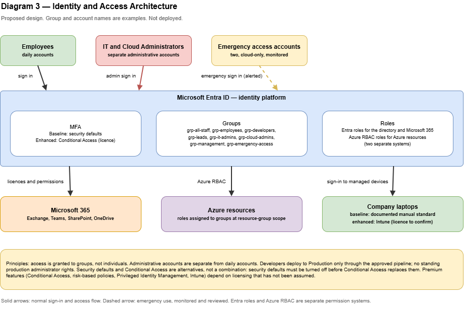

# Identity Management

> **Proposed, illustrative design.** Nothing here has been configured or tested. Assumption IDs (A-nn) refer to [`../architecture/reference-scenario.md`](../architecture/reference-scenario.md); decisions are in [`../decisions/architecture-decisions.md`](../decisions/architecture-decisions.md) (ADR-010 to ADR-012).
> Licensing statements are taken from official Microsoft documentation, **accessed 2026-11-13**, and must be re-verified before use (see section 12).

Diagram: **Diagram 3 — Identity and Access Architecture** (`diagrams/03-identity-and-access.drawio`).

## 1. Purpose and scope

This document describes how people and devices are identified, authenticated, and authorized in the reference organization, and how company laptops are secured.

**In scope:** Microsoft Entra ID as the identity platform, groups, MFA, administrative accounts, emergency access, password and authentication policy, role-based access, endpoint security, and licensing dependencies.

**Out of scope:** Azure resource design (Phase 5), the detailed lifecycle procedures (see [`../operations/onboarding-offboarding.md`](../operations/onboarding-offboarding.md)), pricing, and product-specific click-paths.

**Platform distinction:** Microsoft Entra ID is the **identity platform**. Microsoft 365 is the **productivity and collaboration platform** that uses it. Azure RBAC grants access to Azure resources, while Entra roles grant administrative rights over the directory and Microsoft 365 services. These are different permission systems.

## 2. Identity-specific assumptions

| ID | Assumption | Consequence |
|----|------------|-------------|
| I-01 | One Entra tenant serves Microsoft 365 and Azure (A-02) | One place for joiners, movers, and leavers |
| I-02 | Users are cloud-only identities; there is no on-premises Active Directory (consistent with N-02) | No directory synchronization design |
| I-03 | The licence tier is unknown (A-03) | Two documented paths: a baseline that works without premium licences and an enhanced path |
| I-04 | Role holders are named people in the illustrative counts of the reference scenario | Role combinations are handled with separate accounts, not shared accounts |
| I-05 | Staff use company-managed Windows laptops (A-08) | Endpoint controls target Windows |

## 3. Identity model

| Object | Design |
|--------|--------|
| User accounts | One named account per person, cloud-only, in the organization's tenant |
| Administrative accounts | A **separate** account for each person who administers (for example `adm-` prefix, illustrative). It is used only for administration, has no mailbox-based daily work, and holds only the roles needed |
| Emergency access accounts | Two cloud-only accounts, see section 6 |
| Groups | Access is granted to **groups, never directly to individuals** (see section 4) |
| Guests | Not part of the baseline. If external collaborators are needed, they are added as guest users with limited access and reviewed |
| Service identities | Pipelines and applications use managed identities or service principals (Phase 5 and 6), not personal accounts |

## 4. Groups and role-based access

Groups mirror the roles in the reference scenario. Membership is the control point for licences, Microsoft 365 permissions, and Azure role assignments.

| Group (illustrative name) | Members | Purpose |
|---------------------------|---------|---------|
| `grp-all-staff` | Everyone | Baseline Microsoft 365 access and policies |
| `grp-employees` | Non-technical staff | Role-based access |
| `grp-developers` | Developers | Development environment access |
| `grp-leads` | Senior developers and team leads | Staging access and production approval |
| `grp-it-admins` | IT administrator accounts | Administrative roles over identity, devices, and Microsoft 365 |
| `grp-cloud-admins` | Cloud administrator accounts | Azure administrative roles |
| `grp-management` | Management | Read-only access to reports and monitoring |
| `grp-emergency-access` | The two emergency accounts | Exclusion from blocking policies |

The detailed permissions per role are in [`access-control-matrix.md`](access-control-matrix.md).

**Trade-off — group-based versus direct assignment**

| Option | Advantage | Disadvantage |
|--------|-----------|--------------|
| Group-based (chosen) | Access changes follow role changes; easy to review and to offboard | Needs a clear naming and ownership convention |
| Direct assignment | Quick for a single exception | Becomes unreviewable; permissions linger after people move |

Group-based assignment is also how Azure RBAC is intended to be used: a role assignment consists of a security principal, a role definition, and a scope, and a group can be the principal.

## 5. Multi-factor authentication

MFA is part of the baseline. How it is **enforced** depends on licensing.

| Path | Mechanism | Licence | What Microsoft documents |
|------|-----------|---------|--------------------------|
| **Baseline** | Security defaults | None; available at no extra cost | MFA registration for all users, MFA for administrators at every sign-in, MFA for privileged activities such as the Azure portal, blocking of legacy authentication, and blocking device code flow. Settings are on or off only, with no customization |
| **Enhanced** | Conditional Access policies | At least Microsoft Entra ID P1. Microsoft states that Microsoft 365 Business Premium also provides Conditional Access | Fully customizable policies. Security defaults must be turned off first |
| **Advanced** | Risk-based policies (Entra ID Protection) | Microsoft Entra ID P2 | Policies that react to sign-in or user risk |

**Trade-off — security defaults versus Conditional Access**

| Option | Advantage | Disadvantage |
|--------|-----------|--------------|
| Security defaults | Free, quick, a sound starting point for small organizations with no premium licence | No exceptions or tuning; one setting for everyone; cannot be combined with Conditional Access |
| Conditional Access | Precise control (by group, application, device state, location) and exclusions such as emergency accounts | Requires licensing and careful design; a policy mistake can lock out administrators |

**Decision (ADR-010):** Security defaults are the baseline and Conditional Access is the documented enhancement, chosen once licensing is confirmed. They are alternatives, not a combination, because Microsoft states that security defaults must be disabled before Conditional Access policies replace them.

Authentication method guidance:

- Prefer an authenticator app with number matching over SMS or voice. The security defaults documentation describes the number-entry prompt as helping to prevent MFA fatigue attacks. (Own recommendation beyond that statement: phishing-resistant methods such as passkeys should be adopted where supported.)
- Do not disable authentication methods that security defaults rely on. Microsoft warns that doing so can lock an administrator out of the tenant.
- Confirm that no legacy protocols are in use before enabling, because security defaults block them.

## 6. Administrative accounts and emergency access

**Principles:**

1. **Separation:** administrators use a daily account for email and browsing and a separate administrative account for administration.
2. **Least privilege:** each administrative account receives only the roles its holder needs, preferably the narrowest role that fits rather than a broad one.
3. **Few global administrators:** the highest-privilege role is limited to a very small number of accounts.
4. **No shared accounts:** every administrative action must be attributable to a person.
5. **Periodic review:** administrative role membership is reviewed on a schedule (section 9).

**Emergency access ("break-glass") accounts.** Microsoft's guidance, paraphrased:

| Topic | Recommendation |
|-------|----------------|
| Number | Two or more, so one remains usable if the other is unavailable |
| Type | Cloud-only, on the `.onmicrosoft.com` domain, not federated or synchronized |
| Authentication | A phishing-resistant, passwordless method (Microsoft recommends passkeys) that differs from the method normal administrators use and does not depend on devices or services that could fail in an emergency |
| Policies | Excluded from Conditional Access policies that block or restrict sign-in, for example through a dedicated group; tested regularly |
| Monitoring | Send sign-in logs to Azure Monitor and alert on any sign-in by these accounts at critical severity |
| Storage | Credentials known only to authorized individuals, stored securely in separate locations, not tied to any individual or personal device |
| Validation | At least every 90 days and after IT staffing or subscription changes |

Note on the baseline path: security defaults have no exclusion mechanism, so emergency access accounts are still subject to security defaults. The credential design must therefore satisfy the MFA requirement. This must be verified before the accounts are relied upon.

Privileged Identity Management (time-limited, approved elevation of roles) requires **Microsoft Entra ID P2 or Entra ID Governance**. It is an optional enhancement and not part of the baseline. Without it, administrative roles are assigned permanently to separate administrative accounts, which makes the review cadence and the separation of accounts more important.

## 7. Password and authentication policy

| Area | Baseline |
|------|----------|
| Passwords | Long passphrases preferred over complexity rules; no periodic forced rotation without evidence of compromise; blocking of known-weak passwords where the platform provides it |
| Password manager | Employees use an approved password manager for passwords outside Entra. Azure Key Vault is for **application** secrets, keys, and certificates and is **not** a store for employee passwords |
| Self-service password reset | Enable it only after the authentication methods are verified for the licence in use |
| Account lockout and sign-in logging | Retain sign-in logs and review unusual activity (Phase 7) |
| Legacy authentication | Blocked (security defaults do this; with Conditional Access a policy must do it) |

The password guidance is the author's recommendation and is not attributed to a specific Microsoft statement. The exact policy values should be confirmed against current Microsoft and national guidance when the design is applied.

## 8. Endpoint and device security

Company-managed Windows laptops (A-08, I-05). The controls are listed as baseline or licence-dependent so no dependency is hidden.

| Control | Baseline (no extra licence assumed) | Enhanced (licence or tooling dependent) |
|---------|-------------------------------------|------------------------------------------|
| Disk encryption | BitLocker enabled on every laptop; recovery keys stored in a controlled, documented location | Central enforcement and escrow through device management |
| Operating system updates | Windows Update enabled with a documented patching routine | Managed update rings through device management |
| Endpoint protection | Built-in Windows antimalware kept enabled and updated | Centrally managed endpoint protection and reporting |
| Local accounts | Employees do not use local administrator rights for daily work; administrator rights only for the IT administrator | Enforced by policy through device management |
| Device inventory | A maintained inventory with owner, serial number, and status | Automatic inventory through device management |
| Lost or stolen device | Documented procedure: revoke sessions, disable the account if needed, report | Remote lock or wipe through device management |
| Compliance-based access | Not available | Conditional Access conditions on device compliance (needs Conditional Access and device management) |

**Licensing note — Microsoft Intune.** Microsoft's Intune licensing page states that Intune is included only with the licences listed on its plans and pricing page, and names Microsoft 365 E3, E5, and E7 as examples of bundles that include it. That page does **not** name Microsoft 365 Business Premium, so this document makes **no claim** about whether Business Premium includes Intune. The organization must confirm the position against the current plans and pricing page.

**Trade-off — device management**

| Option | Advantage | Disadvantage |
|--------|-----------|--------------|
| Manual baseline (documented procedures) | No extra licence or tooling | Depends on discipline; no central proof of compliance; scales poorly |
| Intune-based management (when licensed) | Central enforcement, reporting, compliant-device conditions | Licence cost; configuration and operation effort |

**Decision (ADR-011):** a documented manual baseline now, with Intune-based management as the upgrade when licensing is confirmed.

## 9. Access reviews

| Review | Frequency (illustrative) | Reviewer | Content |
|--------|--------------------------|----------|---------|
| Administrative role membership | Quarterly | Management with the IT administrator | Who holds which role and why |
| Group membership | Quarterly and at every role change | Group owners | Remove members who changed role |
| Emergency access accounts | At least every 90 days | IT administrator | Sign-in test, credential custody, documentation |
| Guest accounts (if any) | Quarterly | Sponsor | Remove unneeded guests |
| Azure role assignments | Quarterly | Cloud administrator | Review at subscription and resource-group scope |

Frequencies are illustrative. Automated access review tooling is a licence-dependent enhancement and is not assumed.

## 10. Auditability

- Sign-in and audit logs are retained and reviewed as described in the operations phase. Retention periods are not defined here.
- Administrative actions are attributable to named administrative accounts.
- Any use of an emergency account triggers an alert and a documented review.

## 11. Growth path

| Trigger | Extension |
|---------|-----------|
| Premium licence acquired | Replace security defaults with Conditional Access; add device-compliance conditions |
| Rising privileged activity | Privileged Identity Management for time-limited elevation |
| Growing headcount | Automated joiner and leaver workflows; access review tooling |
| Customer or regulatory demand | Mapping to a compliance framework (not assumed today) |
| On-premises systems appear | Revisit I-02 and design directory synchronization |

## 12. Limitations and verification

- No tenant has been configured. All behavior is described from documentation.
- Licence and feature availability change. Every statement tagged with a licence in this document must be re-verified against current Microsoft documentation before use.
- Not verified here: BitLocker edition and management requirements, self-service password reset by licence, and Intune inclusion in Microsoft 365 Business Premium.
- Role names, group names, and prefixes are examples.

## 13. Well-Architected quick check (self-review, not an official assessment)

| Pillar | Observation |
|--------|-------------|
| Security | MFA baseline, separated administrative accounts, emergency access, group-based least privilege |
| Reliability | Emergency access protects against administrator lockout; no recovery objectives invented |
| Cost Optimization | Free baseline path; paid capabilities deferred and labelled |
| Operational Excellence | Defined reviews, naming, and ownership; lifecycle in a separate document |
| Performance Efficiency | Not materially applicable to identity at this scale |

## 14. Sources

Accessed 2026-11-13. Design choices and recommendations beyond these statements are the author's own.

| Topic | Source |
|-------|--------|
| Security defaults: what they enforce, cost, limitations, relation to Conditional Access | [Microsoft Learn — Security defaults in Microsoft Entra ID](https://learn.microsoft.com/en-us/entra/fundamentals/security-defaults) |
| Licence tiers for Conditional Access, risk-based policies, PIM; Business Premium and Conditional Access | [Microsoft Learn — Microsoft Entra licensing](https://learn.microsoft.com/en-us/entra/fundamentals/licensing) |
| Emergency access accounts | [Microsoft Learn — Manage emergency access admin accounts](https://learn.microsoft.com/en-us/entra/identity/role-based-access-control/security-emergency-access) |
| Azure RBAC model: scopes, role assignments, groups, additive permissions, no extra cost | [Microsoft Learn — What is Azure RBAC?](https://learn.microsoft.com/en-us/azure/role-based-access-control/overview) |
| Intune licensing | [Microsoft Learn — Microsoft Intune licensing](https://learn.microsoft.com/en-us/intune/fundamentals/licensing) |
